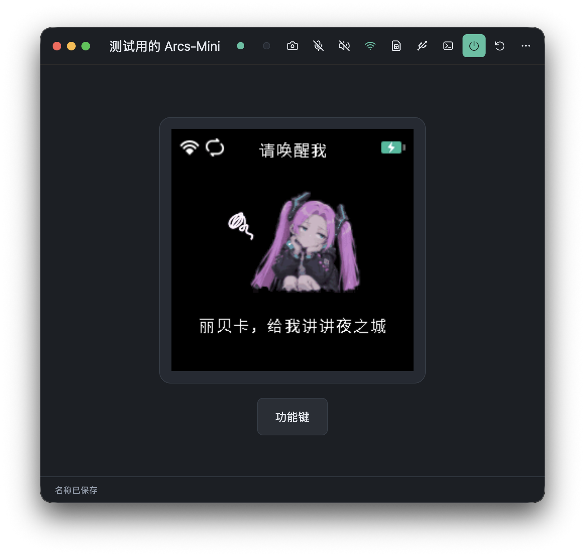

<p align="center">
  
</p>

# Lisem

**在电脑上运行聆思设备固件。**

Lisem 是聆思芯片平台的设备模拟器，基于 QEMU 运行受支持芯片与板型的
原始固件。导入 LPK 后，即可查看固件画面、操作设备按键，并接入电脑的
麦克风、扬声器、摄像头和网络。

在桌面上调试交互，通过 Python 和 pytest 编写固件回归测试，或让 coding
agent 经 MCP 控制设备、读取串口和截图。同一套固件也可以在无头环境中
运行，接入 CI。

[下载应用](https://github.com/LISTENAI/Lisem/releases) ·
[使用说明](docs/usage.md) · [Python SDK](python/README.md) ·
[Coding agent 接入](docs/agents.md)

<p align="center">
  
</p>

## 快速开始

下载对应系统与处理器架构的
[应用包](https://github.com/LISTENAI/Lisem/releases)，解压后打开应用。
支持 macOS、Windows 和 Linux，具体平台要求见对应版本的发布说明。
macOS 也可以通过 Homebrew 安装：

```sh
brew install --cask listenai/tap/lisem
sudo xattr -dr com.apple.quarantine /Applications/Lisem.app
```

准备好目标板型的 LPK 固件包后：

1. 点击实例库右上角的添加按钮，选择「新建实例…」。
2. 选择板型，导入 LPK，创建实例。
3. 双击打开设备并上电；固件若需要长按开机，按住对应的功能键。

固件包需自行准备。当前内置板型如下：

| 芯片 | 平台 | 内置板型 |
| --- | --- | --- |
| LS2684 | Arcs | Arcs-Mini、Arcs-EVB |
| LS2663 | Arcs | Arcs-Mini3 |
| CSK7004J8U | VenusA | VenusA RD EVB |

关闭窗口或退出应用后，设备继续在后台运行；使用下电按钮停止设备。
媒体接入、串口连接和固件写入见[使用说明](docs/usage.md)。

## 用 Python 编写固件测试

随应用提供的 Python SDK 支持实例管理、按键、音视频输入，以及 UART、
截图和数字信号观测。还可作为虚拟蓝牙中心端，与 Arcs 固件进行 GATT
读写和通知交互。用 pytest 组织回归，或用状态机测试探索输入组合，按用例
保存日志、截图、音频和动作记录。

从应用菜单选择「安装命令行工具」，准备 Python 3.10+。以下示例在临时设备
上运行内置 ROM，并长按功能键一秒。保存为 `example.py`，通过
`lisem python -- example.py` 运行：

```python
from lisem import Client

with Client(data_dir="test-output/library") as client:
    with client.temporary_instance(board="arcs-mini") as device:
        with device.start(max_virtual_seconds=10, timeout=30, download=True) as run:
            result = run.button(hold_ms=1000)
            print(result.status)
```

应用固件的启动、交互与断言用例见[固件测试示例](python/examples/README.md)，
蓝牙扫描、属性发现与通知订阅见 [BLE 接口](python/docs/ble.md)。

在测试虚拟环境中安装 pytest 后，通过同一入口运行测试：

```sh
lisem python -- -m pytest tests/
```

SDK 版本与应用配套，无需单独安装。示例使用的临时实例功能目前支持
macOS 和 Linux。平台支持与 IDE 接入见 [Python SDK](python/README.md)，
接口与 pytest 集成见 [Python API](python/docs/README.md)。

## 让 coding agent 操作设备

通过 MCP 或 CLI，让 agent 启动固件、执行长按与连按、提供音视频输入，
结合 UART、截图和信号变化定位问题。例如，让 agent 长按设备功能键，
观察启动日志并返回当前画面，再根据固件输出继续检查。

安装 [Lisem skill](skills/lisem/SKILL.md)，为 agent 提供设备操作、板型配置和
Python 固件测试指导：

```sh
npx skills add LISTENAI/Lisem
```

MCP 服务由 `lisem mcp` 启动，客户端配置见[接入说明](docs/agents.md)。

## 文档与开发

| 文档 | 内容 |
| --- | --- |
| [使用说明](docs/usage.md) | 首次运行、桌面操作、外设接入与 CLI |
| [Python SDK](python/README.md) | 脚本启动、API、pytest 与固件测试示例 |
| [Coding agent 接入](docs/agents.md) | MCP 配置、工具与 Lisem skill |
| [自动化运行](docs/automation.md) | 运行期限、动作编排与证据采集 |
| [自定义板型](docs/boards.md) | 器件能力查询、JSON 格式与接线 |
| [开发说明](docs/development.md) | 构建、验证与发布 |
| [架构说明](docs/architecture.md) | 芯片、器件、宿主接口与运行控制 |

问题反馈与功能建议欢迎提交到
[Issues](https://github.com/LISTENAI/Lisem/issues)。

独立自有源码采用 MIT，QEMU 相关代码保留 GPL；LUNA 静态库与芯片 ROM 使用
单独许可。详见 [LICENSE](LICENSE)。
