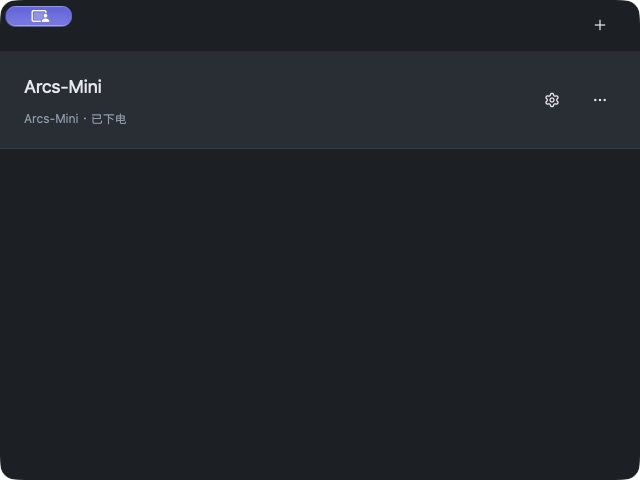

<p align="center">
  
</p>

# Lisem

**在电脑上运行聆思设备固件。**

Lisem 是聆思芯片平台的设备模拟器。导入真机固件，就能在桌面上查看屏幕、
操作按键、连接串口，并通过电脑的麦克风、扬声器和网络与设备交互。也可以用
`lisem` 命令管理和运行设备，把固件测试放进脚本或 CI。

可在 macOS、Windows 和 Linux 上使用，支持 **LS2684（ARCS）** 的
**Arcs-Mini / Arcs-EVB**、**LS2663（ARCS）** 的 **Arcs-Mini3**，以及
**CSK7004J8U（VenusA）** 的 **VenusA RD EVB**。
可导入 JSON 配置内置器件、连线和信号输入，见[自定义板型](docs/boards.md)。

## 开始使用

从[下载页面](https://github.com/LISTENAI/Lisem/releases)选择适合操作系统和
处理器架构的应用包，解压后打开 Lisem。

macOS 也可以通过 Homebrew 安装：

```sh
brew install --cask listenai/tap/lisem
```

安装后可打开 Lisem，也可在终端直接使用 `lisem` 命令。

### 创建第一台设备

1. 打开 Lisem，点击右上角的添加按钮，选择「新建实例…」，
   选择 **Arcs-Mini** 或 **Arcs-EVB**。
2. 导入对应板型的 LPK 固件包，创建实例。
3. 双击实例，在右上角上电。Arcs-Mini 固件若需要长按开机，按住下方的功能键。

固件包需要自行准备。每台设备的固件、设置和设备身份独立保存，重新打开即可
继续使用。点击列表中的齿轮按钮可打开设备设置。



### 与设备交互

各操作入口按板型的可用器件显示。

- **按键**：鼠标按下与松开分别对应真实按键的按下与松开。
- **触摸**：Arcs-EVB 支持在屏幕上点击和拖动。
- **声音**：默认播放设备音频；在麦克风菜单或实例设置中选择「系统麦克风」
  即可输入，运行中也可切换。
- **摄像头**：在摄像头菜单选择图片；macOS 也可选择电脑上的摄像头实时取景。
- **串口**：先启用 UART 并连接，再上电即可看到启动日志。macOS/Linux 使用
  picocom 等串口工具，Windows 使用 PuTTY 的 Raw TCP 连接。
- **SD 卡**：在 SD 卡菜单插入 raw 镜像或弹出，支持运行中更换；分区和文件
  系统由固件读取，镜像内容会保留设备写入。
- **信号输入**：从设备窗口的「实例」菜单展开面板，可随时修改板型提供的
  数字电平和模拟电压。
- **网络**：默认提供开放热点 `Lisem`。在 Wi-Fi 菜单的「热点设置…」中，
  可随时添加、修改或移除热点，设置名称、信号强度、信道及 WPA2 密码，查看
  固件的连接状态。每个热点的「互联网」开关控制外网访问；「热点可用」控制
  所有热点出现或消失。

上电、复位、声音和串口入口位于设备窗口右上角。关闭窗口或退出 Lisem 后，
实例继续在后台运行；需要停止时先下电。更多操作见[使用说明](docs/usage.md)。

## 命令行

桌面与 CLI 共用实例库。从 Lisem 菜单选择「安装命令行工具」，按提示设置
终端命令。也可直接运行包内 CLI：macOS 位于 `Lisem.app/Contents/MacOS/lisem`，
Windows/Linux 位于解压目录中的 `lisem.exe` / `lisem`。以下用 `lisem` 表示
该命令：

```sh
# 创建实例；INSTANCE_ID 使用创建结果中的 ID
lisem create --board arcs-mini --name Mini --lpk firmware.lpk
# Arcs-EVB 使用对应板型的 LPK
lisem create --board arcs-evb --name EVB --lpk arcs-evb.lpk
lisem list

# 在前台运行，适合脚本与 CI
lisem run INSTANCE_ID --seconds 30 --timeout 120

# 后台运行并交互
lisem start INSTANCE_ID --seconds 120 --timeout 180
lisem button INSTANCE_ID function press  # Arcs-Mini
# 按需等待，再松开
lisem button INSTANCE_ID function release
lisem screenshot INSTANCE_ID screen.png
lisem reset INSTANCE_ID
lisem stop INSTANCE_ID
```

运行中可切换热点可用状态、注入 WAV 或侧录音频：

```sh
lisem access-point INSTANCE_ID off
lisem access-point INSTANCE_ID on
lisem audio-input INSTANCE_ID input.wav
lisem audio-output INSTANCE_ID --capture output.wav
```

WAV 输入要求系统麦克风关闭，文件为 16 kHz、单声道 PCM16，最长 24 小时。
注入按 1:1 实时节拍执行，命令等待输入完成；Ctrl+C 取消剩余输入。侧录持续
到 Ctrl+C，保存设备的原始音频输出。结束注入或侧录后，设备继续运行。

CLI 默认不启用宿主网络和音频。使用 `--json` 获取结构化结果，使用 `--data-dir`
指定独立实例库。Flash 导入、擦除、UID 管理及其他命令见
[CLI 使用说明](docs/usage.md#无头命令行)或 `lisem --help`。

## 支持范围

可运行 Arcs-Mini 和 Arcs-EVB 原始固件的显示、按键、存储、LUNA 推理和
语音交互流程。Arcs-EVB 的 ADC 按键通过 `k1`、`k2`、`k3` 控制，三个按键
共用板上的 ADC 电阻梯。内置芯片 ROM，也支持通过虚拟 UART 执行 ROM
烧录流程。

GC0328 摄像头可选图片作为输入，macOS 支持宿主摄像头实时取景。

Windows 的 UART 是 TCP 端点，不能直接交给只接受 COM 串口的烧录工具。
Lisem 面向应用运行与调试，不能代替真机的电气、射频和精确时序验证。

## Coding agent

可通过 `lisem mcp` 接入 MCP，也可让 agent 直接使用 CLI，
详见[接入说明](docs/agents.md)。

[Lisem skill](skills/lisem/SKILL.md) 提供安装、实例操作和固件自动回归指导，
使用以下命令安装：

```sh
npx skills add LISTENAI/Lisem
```

## 参与开发

构建依赖、源码结构和验证方法分别见[开发说明](docs/development.md)与
[架构说明](docs/architecture.md)。

```sh
make build
make run
```

问题反馈与功能建议欢迎提交到
[Issues](https://github.com/LISTENAI/Lisem/issues)。

独立自有源码采用 MIT，QEMU 相关代码保留 GPL；LUNA 静态库与芯片 ROM 以二进制
形式随仓库提供，使用单独许可。详见 [LICENSE](LICENSE)。
